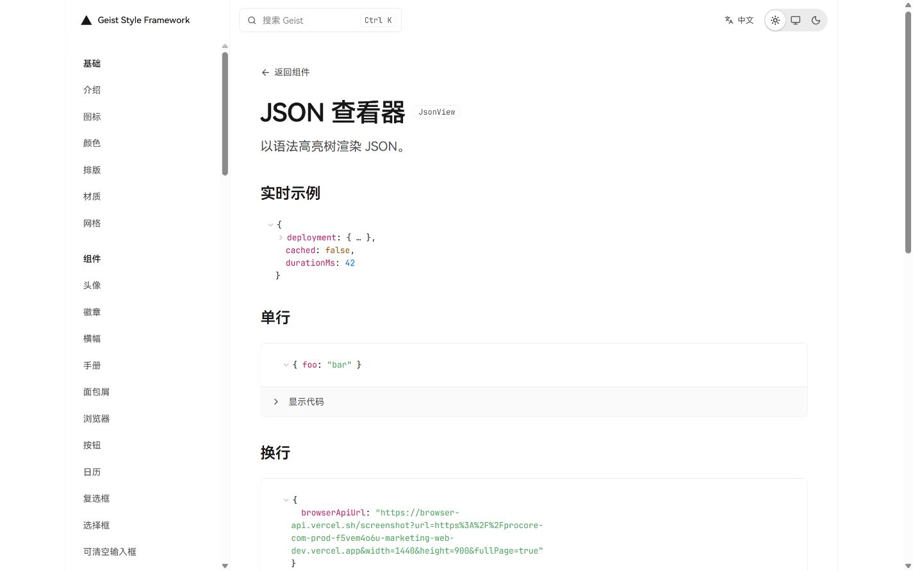
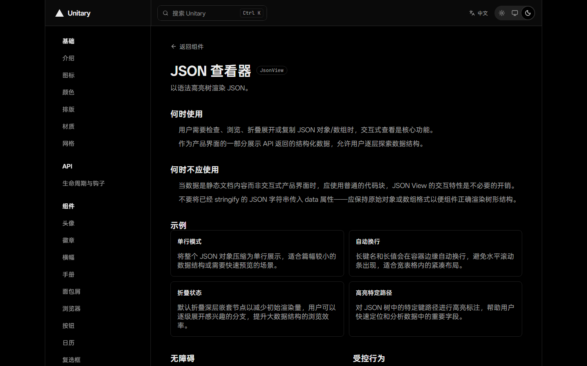

# Unitary UI

[← 简体中文版本：README.md](./README.md)

A reusable **Vercel Geist style framework** built on shadcn/ui — design tokens + base components + an official spec snapshot, ready for direct reuse in consuming projects. npm package `@hustradio/unitary-ui`, MIT licensed.

## Features

- **Geist token system**: dual-theme (light/dark) semantic tokens + full color scales + typography utilities + materials, all aligned with officially measured values (`src/styles/index.css`)
- **Base components**: `src/components/ui/` covers the official Geist component set plus local extensions; routes, sidebar, and docs registry are generated uniformly with zero business dependencies
- **Spec snapshot**: `docs/geist-markdown-refs/` — a frozen snapshot of the official Vercel Geist documentation (foundations + components + measured rendering parameters)
- **Living styleguide**: `src/App.tsx` + composed examples (form / data table / workflow / settings)
- **Docs site**: `docs/geist/` replicates the official docs site structure, bilingual (zh-CN / en-US), dual-theme, with per-component API tables, live demos, and Show Code
- **LLM reference corpus**: `docs/llm/` generates Simplified Chinese (primary) and English (alternative) Markdown per docs route, plus a machine-readable index

## Installation

```bash
pnpm add @hustradio/unitary-ui
```

Or consume it as a style foundation layer: copy `src/styles/`, `src/components/ui/`, and `src/lib/` into your project.

Dependencies: react / react-dom / radix-ui / lucide-react / class-variance-authority / clsx / tailwind-merge / tw-animate-css / date-fns / @date-fns/tz / @fontsource/maple-mono / tailwindcss (`@tailwindcss/vite`).

## Quick start

```tsx
import { Button } from "@hustradio/unitary-ui";
import "@hustradio/unitary-ui/styles";

export function App() {
  return <Button onClick={() => console.log("deploy")}>Deploy Project</Button>;
}
```

Style entry (when consuming the source directly):

```ts
import "@/styles/index.css";
```

## Documentation

- Human docs site: `vp dev docs/geist` (Introduction / Colors / Typography / Materials / Components, with zh-CN/en-US and light/dark switching)
- Docs contract tests: `tests/component-doc-completeness.test.ts`, `tests/docs-i18n-parity.test.ts`
- Official spec snapshot: `docs/geist-markdown-refs/`
- Known issues list: `docs/geist-docs-findings.md`
- Change history: [CHANGELOG.en.md](./CHANGELOG.en.md)

### Screenshots

|                     | Light                                               | Dark                                           |
| ------------------- | --------------------------------------------------- | ---------------------------------------------- |
| Components overview |  | —                                              |
| JSON viewer         |     |  |
| Form example        |             |      |
| Data table          |                 |  |
| Workflow            |                     | —                                              |
| Settings panel      |               | —                                              |

These example images are generated by Playwright from the real living styleguide and docs site rather than composed manually. After changing components, composed examples, themes, or layout, run:

```bash
vp run docs:readme:screenshots
```

The command starts temporary preview servers and regenerates the light/dark screenshots referenced by the README under `images/` at a fixed 1440×900 viewport. Review the image diffs before committing.

## LLM / AI agent usage

See [`llm/README.en.md`](./llm/README.en.md) (English) / [`llm/README.md`](./llm/README.md) (Simplified Chinese primary) for versioned LLM task packages, ordered prompt fragments, and the unified entry point. An LLM can locate prompts by reading the registry, manifest, and listed fragment paths; running `vp run` is not a discovery prerequisite.

The instruction text below is kept in English in both locale versions to avoid semantic divergence:

1. Read `AGENTS.md` first.
2. Query `docs/llm/index.json` for the relevant route.
3. Load only the matching Markdown pages.
4. Verify component exports and TypeScript props in source.
5. Never invent undocumented APIs.
6. Run the documented checks before proposing a change.

## Development

```bash
pnpm install
pnpm dev                 # living styleguide
vp dev docs/geist        # docs site
pnpm test                # contract + unit tests
pnpm typecheck
vp run docs:readme:screenshots # regenerate README example images
vp run docs:llm:generate # regenerate LLM corpus after docs changes
vp run docs:llm:check    # drift check (exit 0 = no drift)
```

Before contributing: run `pnpm test` and `pnpm typecheck`; after docs changes you must regenerate the LLM corpus and keep both locales aligned. Never `git add -A` — stage files explicitly.

## Contributing

1. Read the task-to-source map in `AGENTS.md` first to locate the right source files
2. Component changes must update together: component source, registry entry, API rows, demos, zh-CN descriptions, bilingual guides
3. After component-example, theme, or layout changes run `vp run docs:readme:screenshots`; after docs changes run `vp run docs:llm:generate`; then run the relevant contract tests
4. Use clear verb phrases in commit messages; never bypass hooks with --no-verify

## Security

Report security vulnerabilities through the repository's private channel; do not disclose them in public issues. This repository collects no telemetry; the docs site's clipboard permission is used only for copying code snippets.

## Credits

Design references and third-party asset inventory: [`CREDITS.en.md`](./CREDITS.en.md) (English) / [`CREDITS.md`](./CREDITS.md) (Simplified Chinese primary). Full license notices for third-party code and fonts: [`THIRD_PARTY_NOTICES.en.md`](./THIRD_PARTY_NOTICES.en.md) / [`THIRD_PARTY_NOTICES.md`](./THIRD_PARTY_NOTICES.md).

## Font redistribution risk

The npm package includes all 15 processed webfont subsets: nine JetBrains Maple Mono files, three OPPO Sans 4.0 files, and three HarmonyOS Sans files. The Maple subsets are distributed under OFL-1.1, whose full text ships as [`OFL-1.1.txt`](./OFL-1.1.txt). Available public material establishes the origin and free-commercial-use statements for OPPO Sans and HarmonyOS Sans, but the current official pages do not provide a reproducible, complete authorization chain for subsetting, modification, and onward redistribution. Anyone republishing the npm package or mirroring these fonts must perform their own legal review and accepts that risk. Downstreams requiring a strict, auditable license chain should not redistribute those six subsets unchanged.

## License

MIT © 2026 HUSTRadio. The legally authoritative text is the English [`LICENSE`](./LICENSE); see [`LICENSE.zh-CN.md`](./LICENSE.zh-CN.md) for an unofficial, non-binding Simplified Chinese reading guide.

Third-party fonts and code are not covered by this license; see the notices files above for their license status.
