# Unitary UI

[简体中文](./README.md)

To LLM Agents: see [AGENTS.md](./AGENTS.md) for llm-specified documentation.

A React component library based on the Vercel Geist design language, with design tokens, base components, composed examples, and bilingual documentation.

## Features

- Light and dark themes with semantic design tokens
- Common Geist components and local extensions
- TypeScript APIs, live examples, and copyable code
- Motion.dev interaction animations and controllable Hitu SVG illustrations
- Composed form, data table, workflow, and settings examples
- Simplified Chinese and English documentation

## Installation

```bash
pnpm add @hustradio/unitary-ui
```

## Quick start

```tsx
import { Button } from "@hustradio/unitary-ui";
import "@hustradio/unitary-ui/styles.css";

export function App() {
  return <Button>Deploy Project</Button>;
}
```

The package root supports native Node ESM `import` and CommonJS `require` without a CSS loader. Browser applications must still import `@hustradio/unitary-ui/styles.css` explicitly; this file includes Device frame styles. Do not import the CSS file directly in Node server code.

## Screenshots

<!-- STYLEGUIDE_SCREENSHOTS_START -->

| Page                     | Light                                                                  | Dark                                                                 |
| ------------------------ | ---------------------------------------------------------------------- | -------------------------------------------------------------------- |
| Pagination and media     | 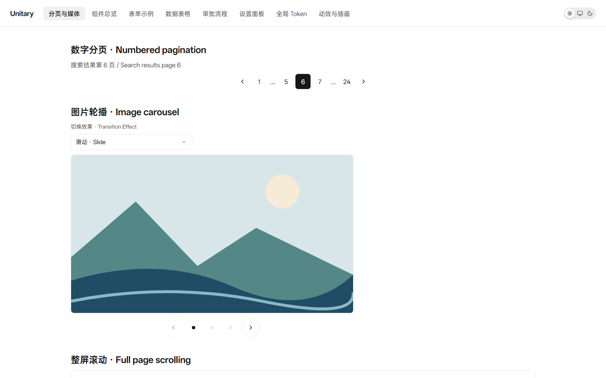 | 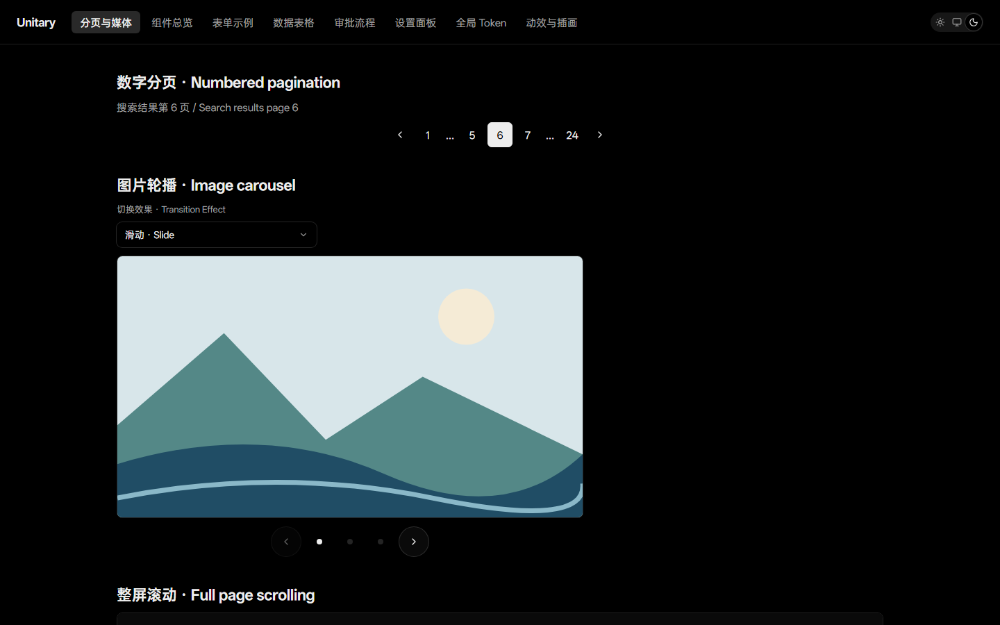 |
| Components overview      | 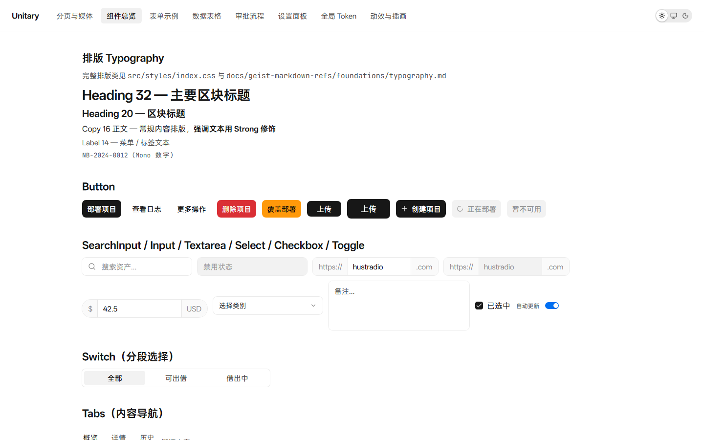   | 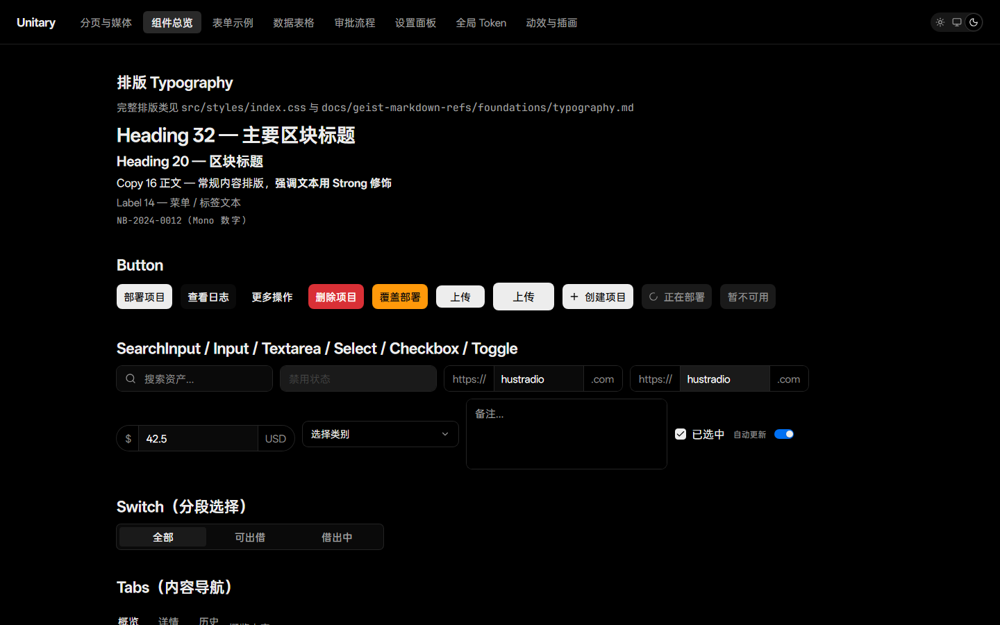   |
| Form example             | 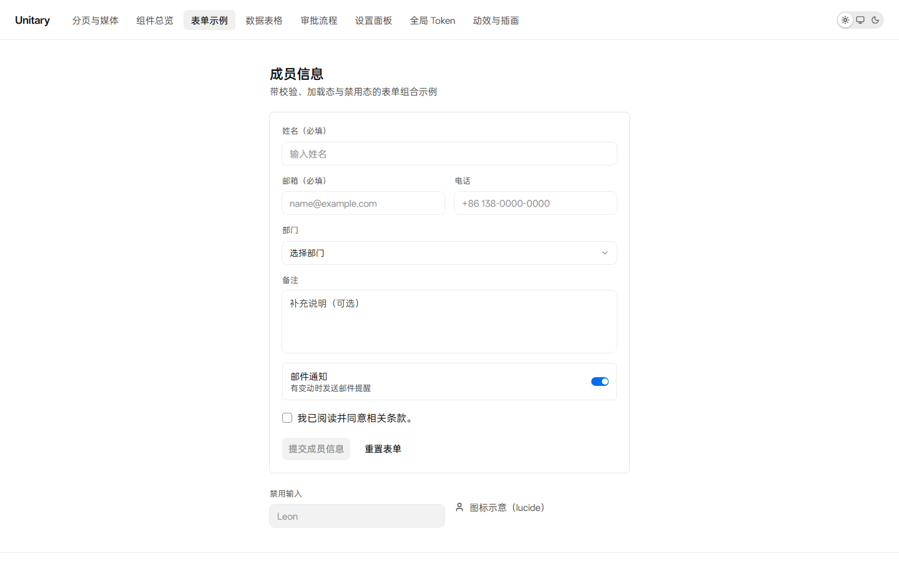                | 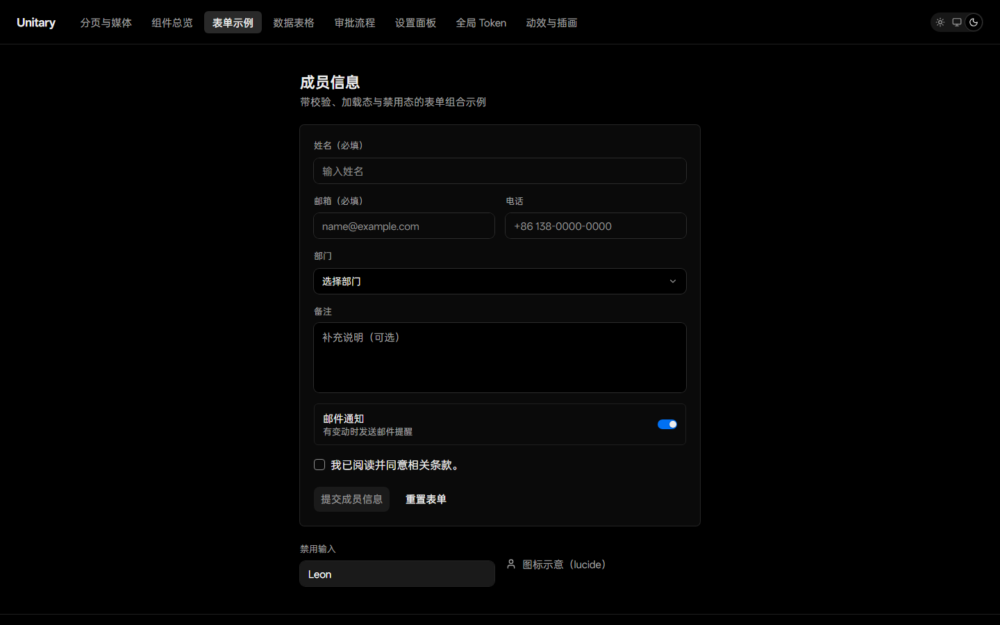                |
| Data table               | 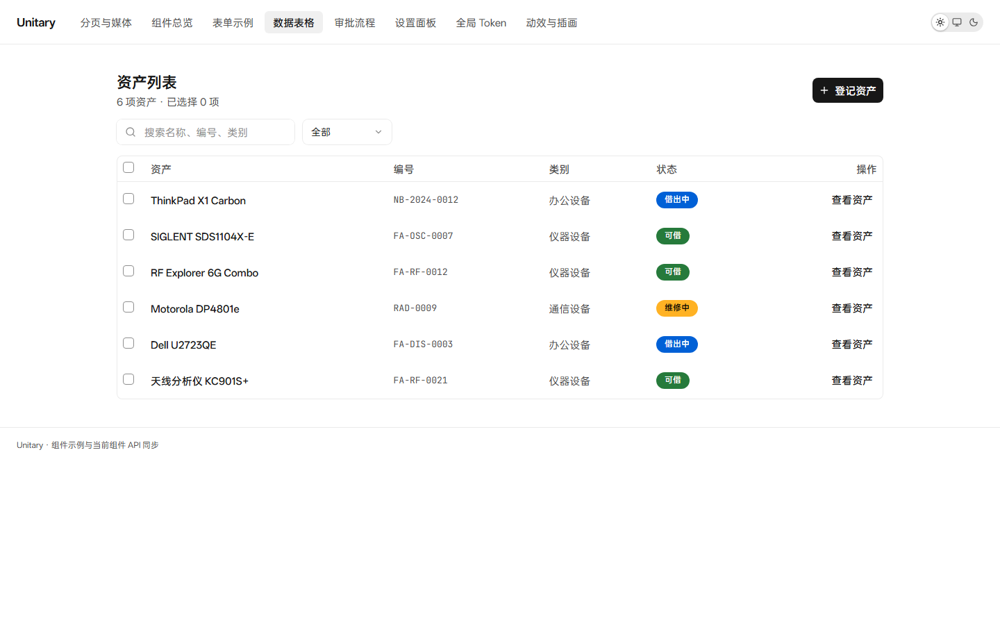                 | 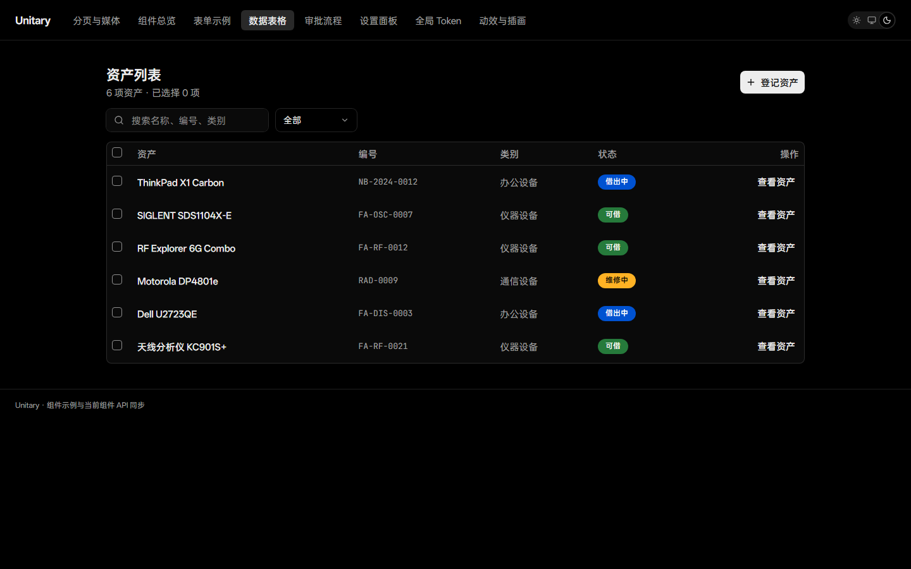                 |
| Workflow                 | 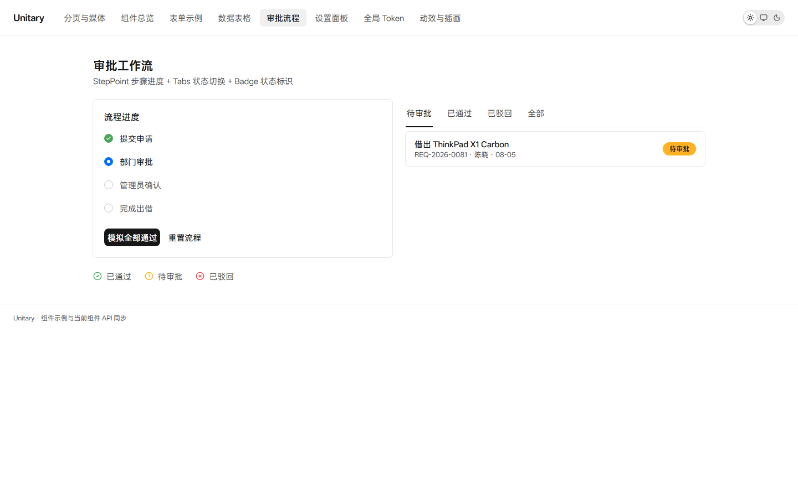                | 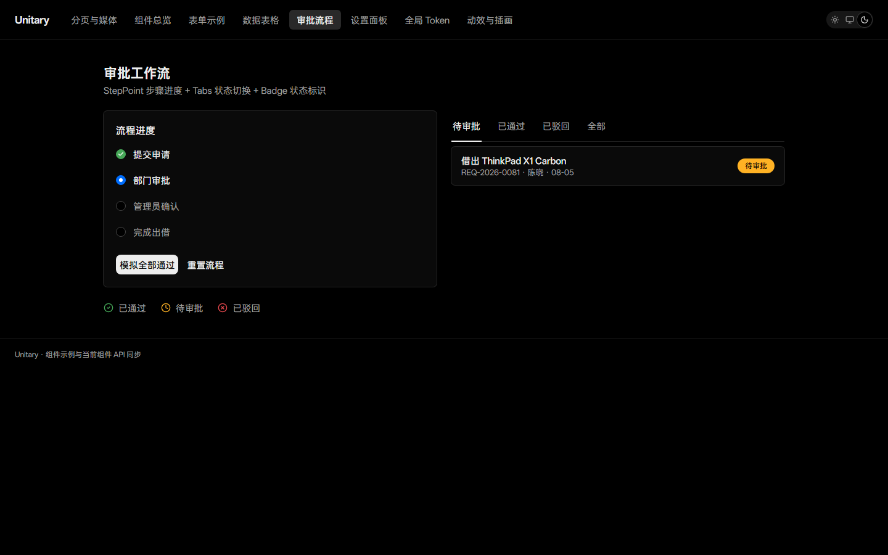                |
| Settings panel           | 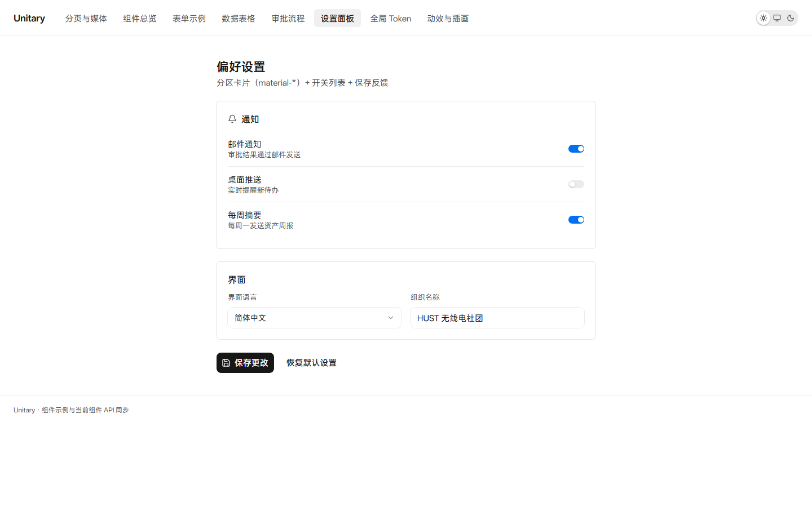          | 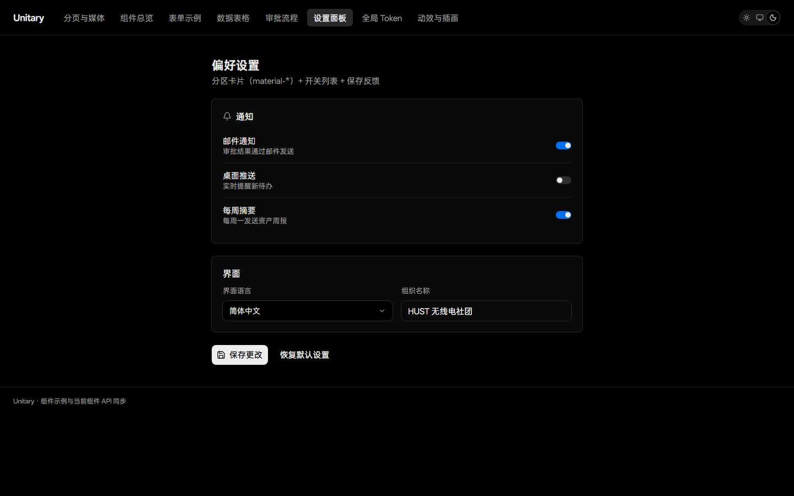          |
| Global tokens            | 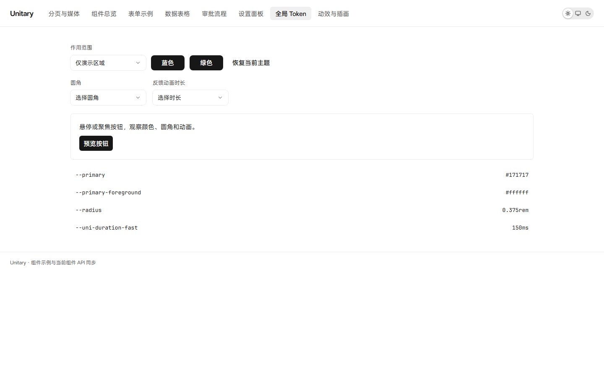             | 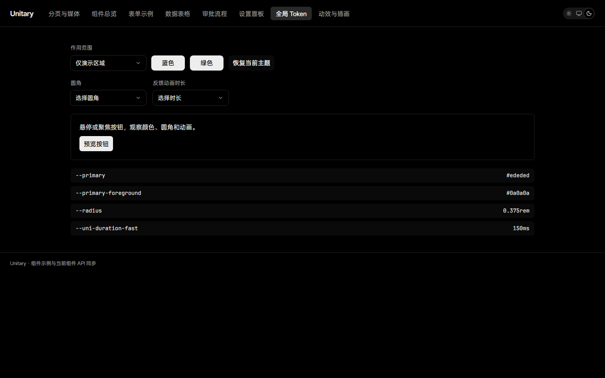             |
| Motion and illustrations | 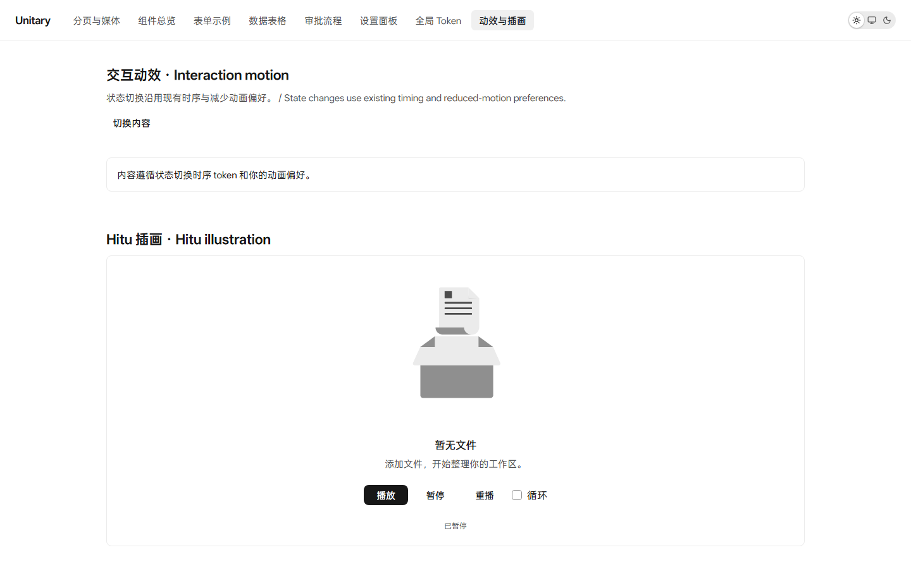  | 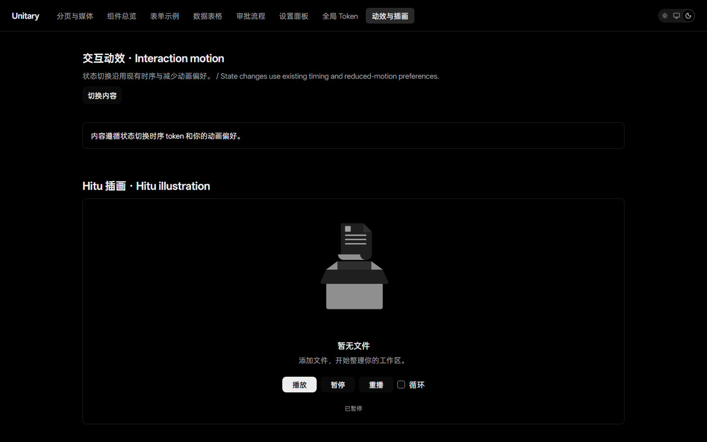  |

<!-- STYLEGUIDE_SCREENSHOTS_END -->

## Documentation

- Documentation site: `vp dev docs`
- Motion and illustrations: [`Hitu + Motion guide`](./docs/guides/hitu-motion.en.md)
- Integration verification: [`Tests and bundle measurements`](./docs/audits/hitu-motion-2026-10-08.md)
- Official specification snapshot: [`docs/geist-markdown-refs`](./docs/geist-markdown-refs)
- Changelog: [`CHANGELOG.en.md`](./CHANGELOG.en.md)

## Color guidelines

The foundation scales use **Vercel Geist Colors**, with a reference snapshot in `docs/geist-markdown-refs/foundations/colors.md` and definitions in `src/styles/index.css`. `--uni-*` maps these colors to specific uses. Apple HIG guides layout, interaction, and accessibility without adding another palette. Color overrides must document their source, reason, and scope.

## Development

```bash
pnpm install
pnpm dev
pnpm test
pnpm typecheck
```

Package validation before publishing (automatically run by `prepublishOnly`):

```bash
pnpm exec playwright install chromium
pnpm run test:package
```

This rebuilds the library, checks ESM/CJS imports, server rendering, and code highlighting in separate Node processes, then verifies Device dimensions and layout with the published CSS in Chromium.

## Credits

See [`CREDITS.en.md`](./CREDITS.en.md) for design references and third-party assets. Redistribution of OPPO Sans and HarmonyOS Sans carries licensing risk; see [`THIRD_PARTY_NOTICES.en.md`](./THIRD_PARTY_NOTICES.en.md).

## License

MIT © 2026 HUSTRadio. See [`LICENSE`](./LICENSE) for the legal text and [`LICENSE.zh-CN.md`](./LICENSE.zh-CN.md) for a Simplified Chinese reading guide.
