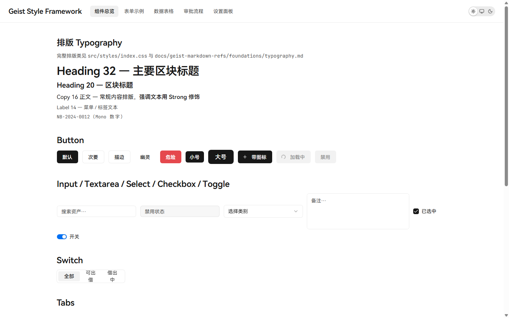
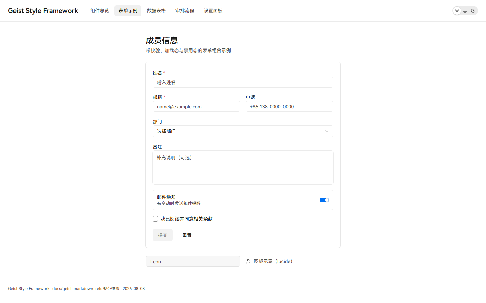
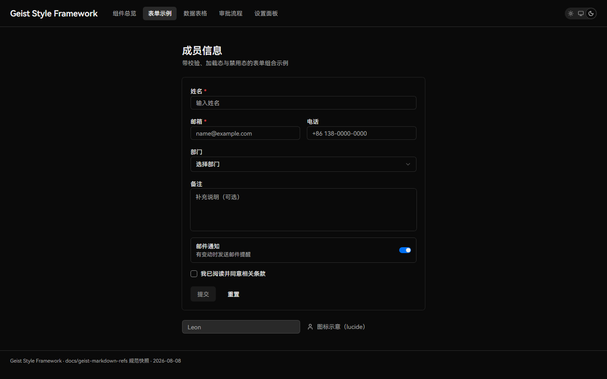
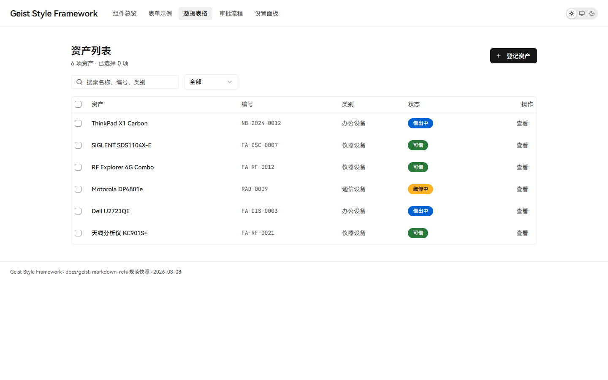
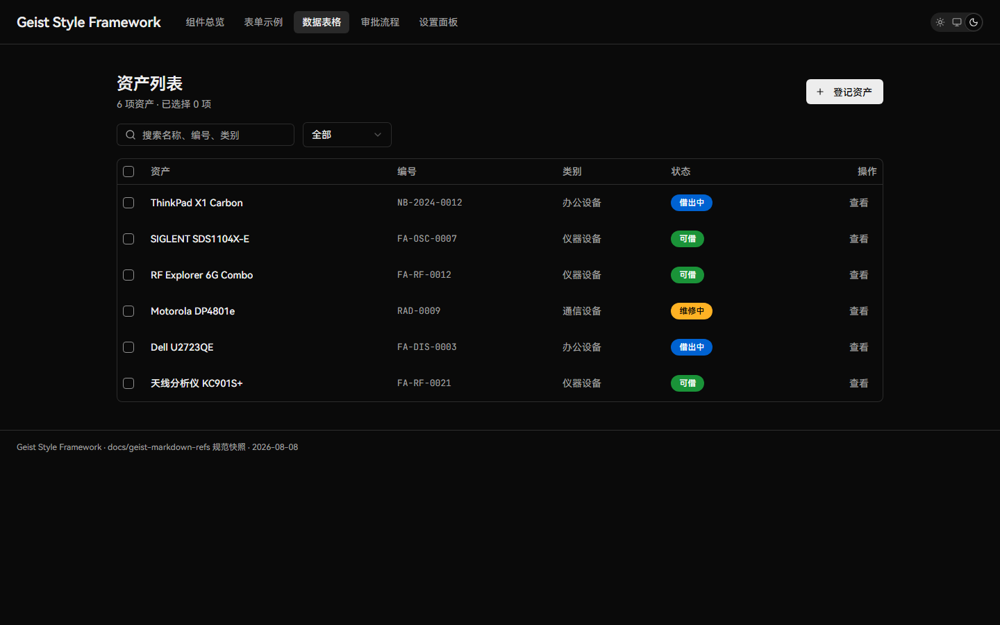
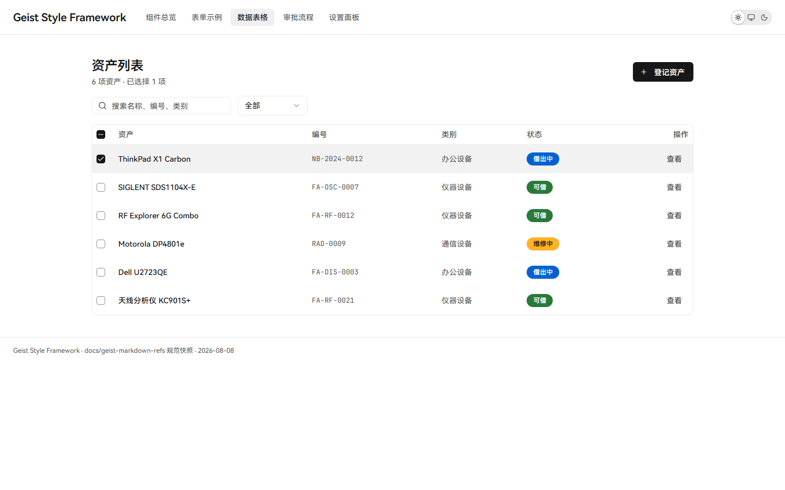
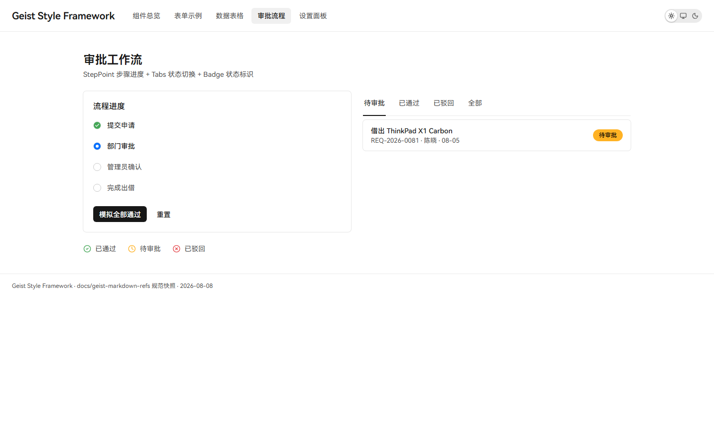
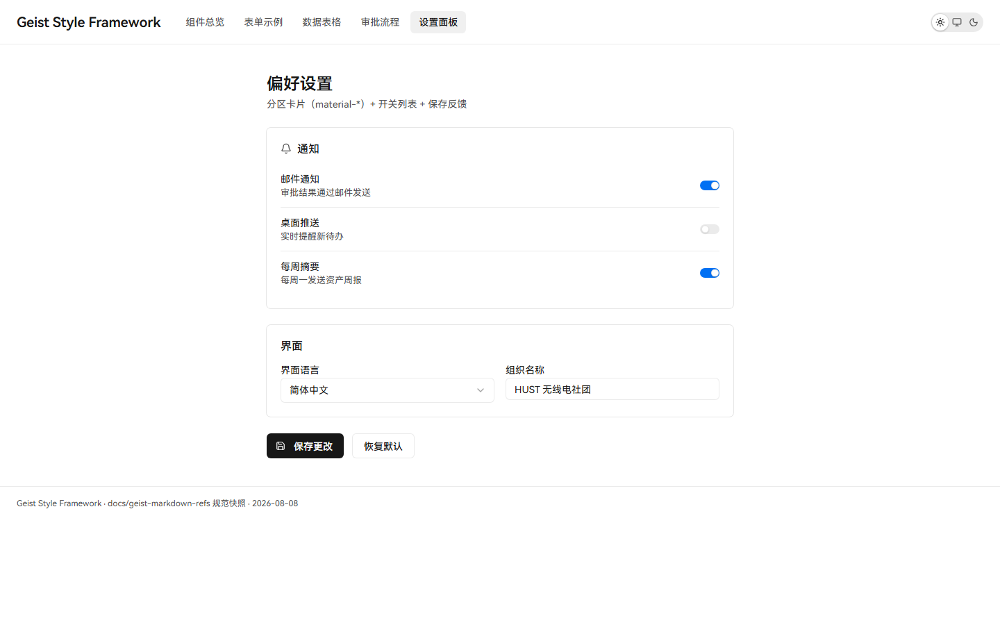

# Geist Style Framework

基于 **shadcn/ui** 的可复用 **Vercel Geist 样式框架**——样式 token 体系 + 基础组件 + 官方规范快照，供消费方项目直接复用。

> 从 [oa-frontend](https://github.com/HUSTRadio/oa-frontend) 抽离而来：该项目的 Geist 视觉基础设施（token / 组件 / 规范快照 / agent 约束）独立成库，业务页面留在原仓库。

## 内容

| 资产              | 路径                        | 说明                                                                                                                                                            |
| ----------------- | --------------------------- | --------------------------------------------------------------------------------------------------------------------------------------------------------------- |
| 样式 token 体系   | `src/styles/index.css`      | Geist 双主题 34 语义 token + 82 全色阶 + 排版工具类 + material-* 材质 + focus-ring（官方实测值）                                                                |
| 基础组件          | `src/components/ui/`        | 覆盖 72 个官方 Geist 组件，并保留本地 Step Point 扩展；文档 registry、路由与侧栏统一生成（零业务依赖）                                                          |
| 工具              | `src/lib/`                  | `utils.ts`（cn）、`theme.tsx`（light/dark/system 三态主题系统）                                                                                                 |
| 规范快照          | `docs/geist-markdown-refs/` | Vercel Geist 官方文档快照（foundations + 72 组件 + 渲染参数实测表 + 截图，13MB）                                                                                |
| Agent 约束        | `AGENTS.md`                 | 框架通用开发约束（Geist 视觉规范 / Git 规范 / Vite+ 流程）                                                                                                      |
| Living styleguide | `src/App.tsx`               | 组件总览 + 4 个组合示例导航                                                                                                                                     |
| 组合示例          | `src/examples/`             | FormExample（表单校验/加载态）/ DataTableExample（表格+筛选+选择）/ WorkflowExample（审批步骤）/ SettingsExample（设置面板）                                    |
| 文档站            | `docs/geist/`               | 复刻 Vercel Geist 官方文档站（Introduction/Colors/Typography/Materials/Brands/Components），`vp dev docs/geist` serve；问题清单见 `docs/geist-docs-findings.md` |

## 效果图

### 组件总览（Light）



### 表单示例（Light / Dark）




### 数据表格（Light / Dark / 选中行）





### 审批流程（Light）



### 设置面板（Light）



## 快速开始

```bash
vp install
vp dev        # living styleguide @ localhost
vp check
vp build
```

## 消费方式

消费方项目（如 oa-frontend）复制以下三部分即可获得完整 Geist 基础层：

```bash
# 1. 样式体系（含字体引用）
cp -r geist-style-framework/src/styles/ <项目>/src/styles/
cp -r geist-style-framework/public/fonts/ <项目>/public/fonts/

# 2. 基础组件
cp -r geist-style-framework/src/components/ui/ <项目>/src/components/ui/

# 3. 工具
cp geist-style-framework/src/lib/utils.ts <项目>/src/lib/
cp geist-style-framework/src/lib/theme.tsx <项目>/src/lib/
```

然后在项目入口引入样式：

```ts
import "@/styles/index.css";
```

依赖需求：react / react-dom / radix-ui / lucide-react / class-variance-authority / clsx / tailwind-merge / tw-animate-css / @fontsource/maple-mono / tailwindcss（`@tailwindcss/vite`）。

## 设计约束（消费方也适用）

完整约束见 `AGENTS.md`。核心：

- **Geist 是视觉权威**，shadcn/Radix 仅作行为与无障碍基础设施
- 所有颜色走语义 token / 全色阶，禁止硬编码色值；双主题同语义角色
- 排版只用命名类（`text-heading-*` / `text-button-*` / `text-label-*` / `text-copy-*`），数值见官方实测
- 圆角：表面 6px / 浮层 12px / 全屏 16px；间距 = Tailwind 4px 倍数（Geist 官方尺度）
- 焦点：可交互元素用 `focus-ring`（双环）；输入控件用 `input-focus-ring`（灰阶加深 + 柔光）
- 实现组件视觉前，先查 `docs/geist-markdown-refs/components/<name>.md` 顶部「渲染参数」实测块

## 注意事项

- **字体**：HarmonyOS Sans SC 为 GB2312 中文子集（面向中文 UI），国际场景需替换字体
- **主题存储键**：`geist-theme-preference`（与 oa-frontend 的 `oa-theme-preference` 独立）
- **docs/geist-markdown-refs 体积**：13MB 快照可裁剪（仅保留 `foundations/` + 常用组件）以减小仓库体积
- **Git 签名**：本仓库沿用 oa-frontend 的 LeonhardtHUST GPG 键约定；公开协作时需泛化
- **版本**：依赖与 oa-frontend 完全一致（radix-ui 一体化包 / lucide / tailwind v4），避免版本漂移

## License

Private — HUSTRadio 组织内部使用。
